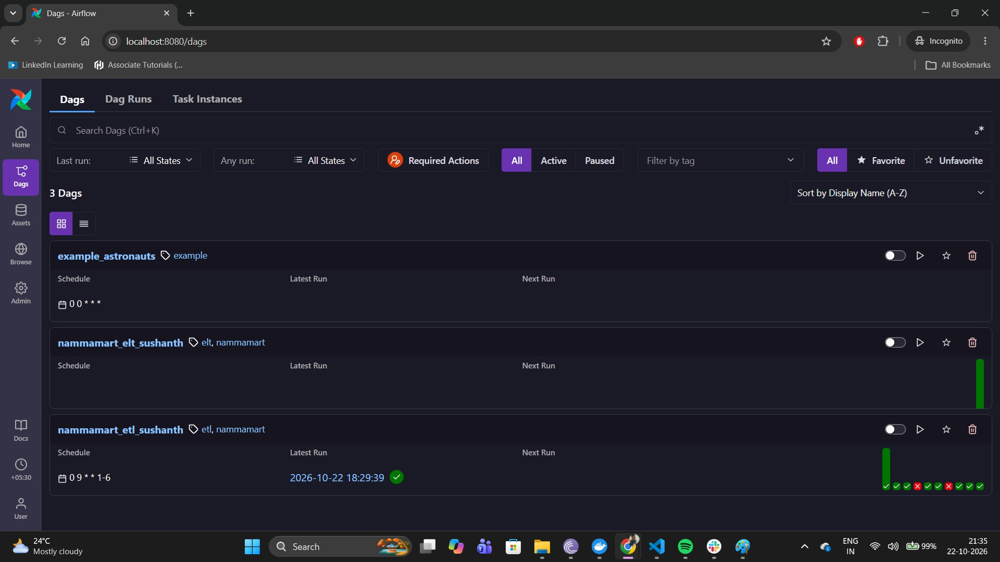
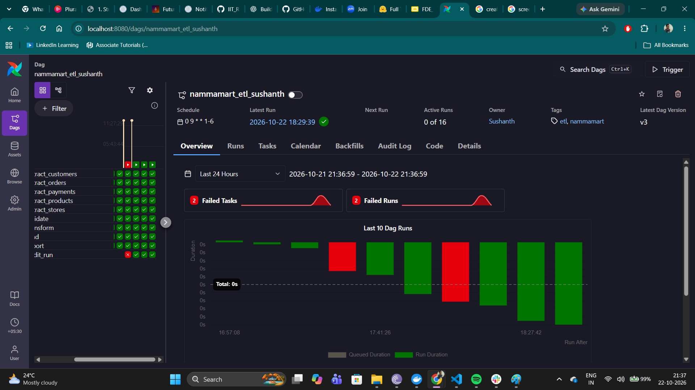
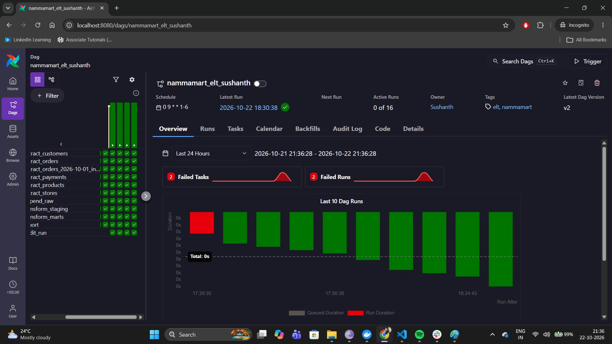
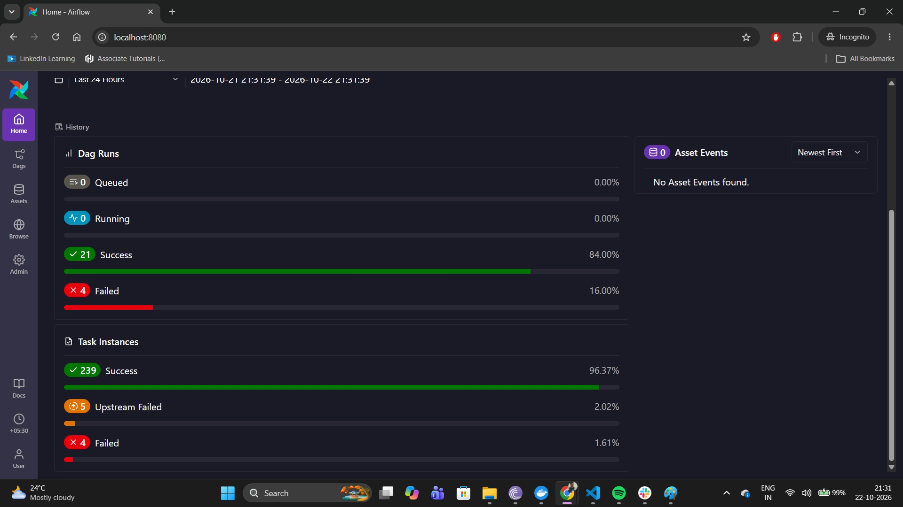

# NammaMart ETL and ELT Submission

## Part C: Scheduling

Both DAGs use the cron expression `0 9 * * 1-6`, which schedules a run at 9:00 AM IST, Monday through Saturday. Their timezone-aware `start_date` is `pendulum.datetime(2026, 9, 1, tz="Asia/Kolkata")`, so Airflow interprets the schedule in India Standard Time.

The scheduled run corresponds to **03:30 UTC** in the Airflow UI. If the DAG timezone were UTC instead, a 9:00 AM cron schedule would run at 9:00 AM UTC, which is **2:30 PM IST**, missing the client's 9:30 AM review.

`catchup=False` prevents Airflow from creating a backlog of historical daily runs when the scheduler is unavailable. This is appropriate for a daily operational report where replaying every missed date is not useful by default; an intentionally requested backfill can be run separately.

The DAG defaults are **2 retries**, a **5-minute retry delay**, and a **30-minute execution timeout**. If the laptop or Docker is off at 9:00 AM, no run can execute while it is offline and the 9:30 AM SLA will be missed. When the scheduler returns, Airflow may schedule the latest eligible run, but with catchup disabled it will not replay the full history of missed intervals. Production delivery therefore requires an always-on Airflow host; a local laptop is suitable for development and demonstration only.

## Part D: Data Quality

Both pipelines write one `dq_results` row per named check and run, with `run_id`, `dag_id`, `check_name`, `dimension`, `severity`, `rows_checked`, `rows_failed`, `status`, and `checked_at`. ETL builds these results from its Python validation frames; ELT creates them in `include/sql/dq_results.sql` from the SQL staging tables. A retry replaces only the scorecard rows for that same DAG and run, preserving prior run history.

| Dimension | Implemented checks | Severity |
| --- | --- | --- |
| Completeness | Required order, payment, customer, product, and store fields; delivered orders require a delivery duration | Critical |
| Uniqueness | Order, payment, customer, product, and store keys | Critical |
| Validity | Allowed order/payment statuses and modes; timestamp parsing; customer email, phone, and pincode formats | Critical for business fields and timestamps; Warning for customer formats |
| Accuracy | Positive quantities and product MRP; discount range; order amount formula; delivery bounds; cost not above MRP | Critical |
| Consistency | Order-to-customer/product/store keys; payment order key and successful payment amount | Critical |
| Timeliness | Future order, payment, and signup timestamps | Critical |

Critical failures are quarantined in ETL or marked `FAIL` in ELT staging. Warning checks do not reject the row and are recorded with `status='WARN'`. The shared scorecard can be inspected with `SELECT * FROM dq_results ORDER BY checked_at DESC, dag_id, check_name`.

## Part E: Data Governance

### 1. Ownership

| Dataset | Owner and quality-rule approver |
| --- | --- |
| Orders | Operations / Order Management System (OMS); Ops owns order statuses and delivery measures. |
| Payments | Finance with the payment-gateway owner; Finance approves reconciliation and payment rules. |
| Customers | CRM / Customer Operations, with the privacy lead responsible for permitted use of customer data. |
| Products | Merchandising / Product Catalogue; Merchandising approves category, cost, and price rules. |
| Stores | Store Operations; Ops approves the store master and zones. |
| Warehouse tables | Data Engineering owns schemas, lineage, access, and pipeline reliability; each domain owner approves changes to their business definitions. |

For example, changing the 120-minute delivery validity limit requires approval from Operations, documented with Finance if it changes reported KPIs. Data Engineering implements the approved rule and records the effective date/version.

### 2. Data Dictionary

Source files: `orders.csv`, `payments.csv`, `customers.csv`, `products.csv`, and `stores.csv` in `include/data/nammamart`. Masking described below applies to ETL dimensions and ELT staging; the ELT raw layer remains an exact, restricted copy.

| Table.column | Type | Meaning and source | Allowed values / rule | PII |
| --- | --- | --- | --- | --- |
| `etl_fact_orders.order_id` | VARCHAR | Order key from orders | Unique, nonblank | No |
| `etl_fact_orders.order_ts` | TIMESTAMPTZ | Order event time from orders | Valid timestamp, not future | No |
| `etl_fact_orders.order_date` | DATE | Calendar date derived from order_ts | Derived | No |
| `etl_fact_orders.customer_id` | VARCHAR | CRM customer key from orders | Must match customer dimension | Yes, pseudonymous/linkable |
| `etl_fact_orders.product_id` | VARCHAR | Product key from orders | Must match product dimension | No |
| `etl_fact_orders.store_id` | VARCHAR | Store key from orders | Must match store dimension | No |
| `etl_fact_orders.quantity` | INTEGER | Units ordered | Greater than zero | No |
| `etl_fact_orders.unit_price` | DOUBLE | Source unit price | Positive | No |
| `etl_fact_orders.discount_pct` | DOUBLE | Source discount percentage | 0 to 100 | No |
| `etl_fact_orders.order_amount` | DOUBLE | Source order total after discount | Must match quantity × unit_price × (1 − discount/100), rounded to 2 decimals | No |
| `etl_fact_orders.payment_mode` | VARCHAR | Payment mode from orders | UPI, Card, Cash on Delivery, Wallet | No |
| `etl_fact_orders.order_status` | VARCHAR | Fulfilment state from orders | DELIVERED, CANCELLED, RETURNED | No |
| `etl_fact_orders.channel` | VARCHAR | Ordering channel | App, Web | No |
| `etl_fact_orders.delivery_minutes` | DOUBLE | Delivery duration | Delivered orders required; under 120 for validity | No |
| `etl_fact_orders.net_revenue` | DOUBLE | Revenue recognized for delivered orders | Zero for non-delivered orders | No |
| `etl_fact_orders.gross_margin` | DOUBLE | Net revenue less quantity × product cost | Derived | No |
| `etl_fact_orders.within_15_min` | BOOLEAN | Delivered within 15 minutes | True/False | No |
| `etl_dim_customer.customer_id` | VARCHAR | CRM customer key | Unique | Yes, pseudonymous/linkable |
| `etl_dim_customer.full_name` | VARCHAR | Customer name from CRM | Masked as `***` | Yes |
| `etl_dim_customer.email` | VARCHAR | Customer email from CRM | Masked local part; warning if malformed | Yes |
| `etl_dim_customer.phone` | VARCHAR | Customer phone from CRM | First/last two digits shown; warning unless 10 digits | Yes |
| `etl_dim_customer.city`, `area` | VARCHAR | Customer location from CRM | Masked as `***` | Yes |
| `etl_dim_customer.pincode` | VARCHAR | Customer postal code from CRM | Masked; source format is six digits | Yes |
| `etl_dim_customer.signup_date` | TIMESTAMPTZ | CRM signup date | Valid date, not future | Yes when linked to customer |
| `etl_dim_customer.loyalty_tier` | VARCHAR | CRM loyalty level | Bronze, Silver, Gold, Platinum | Yes when linked to customer |
| `etl_dim_customer.is_active` | VARCHAR | CRM account status | Y or N | Yes when linked to customer |
| `etl_dim_product.product_id` | VARCHAR | Catalogue product key | Unique | No |
| `etl_dim_product.product_name`, `sub_category`, `brand`, `unit` | VARCHAR | Product description from catalogue | Source catalogue values | No |
| `etl_dim_product.category` | VARCHAR | Reporting category from catalogue | Nonblank; source category list | No |
| `etl_dim_product.mrp`, `cost_price` | DOUBLE | Retail and unit cost from catalogue | MRP positive; cost no greater than MRP | No |
| `etl_dim_product.is_perishable` | BOOLEAN | Perishability flag from catalogue | True/False | No |
| `etl_dim_product.launch_date` | DATE | Product launch date | Valid date | No |
| `etl_dim_store.store_id` | VARCHAR | Store key from store master | Unique | No |
| `etl_dim_store.store_name`, `zone`, `area` | VARCHAR | Store attributes from store master | Zone: North, South, East, West | No |
| `etl_dim_store.pincode` | VARCHAR | Store postal code | Six digits in source; masked in reporting dimension | No |
| `etl_dim_store.open_date` | DATE | Store opening date | Valid date | No |
| `etl_dim_store.manager_name` | VARCHAR | Store-manager name from store master | Masked as `***` | Yes |
| `etl_dim_store.capacity_orders_per_day` | INTEGER | Daily store capacity from store master | Nonnegative integer | No |

### 3. Lineage
`mart_daily_store_kpis` reports **1,410.80** net revenue for **S01 on 2026-09-01**. It sums delivered `order_amount` for ORD000013 (28.80, source line 1369), ORD000025 (788.00, line 728), and ORD000058 (594.00, line 444) in `orders.csv`; the store dimension supplies S01's name and North zone. ELT preserves `_source_file` and `_run_id` through raw/staging, so the contributing records are directly traceable. ETL can trace the order IDs back to the source CSV, but the current fact does not retain source-row metadata; ELT makes this audit easier.

### 4. Personal Data and Privacy

Customer `full_name`, `email`, `phone`, `city`, `area`, and `pincode` are direct personal data; `customer_id`, `signup_date`, and `loyalty_tier` are linkable personal data. `stores.manager_name` is also personal data. Both reporting paths mask names, phone/email, and location details; identifiers needed for joins remain protected and should be treated as pseudonymous personal data. Masking preserves useful joins and aggregate analysis without exposing direct identifiers.

India's **Digital Personal Data Protection Act, 2023**, and applicable rules govern digital personal data. NammaMart should act as the Data Fiduciary: provide notice and a valid purpose/basis, limit processing to that purpose, apply reasonable security safeguards, honor applicable data-principal rights, and erase data when the purpose and required retention end. Legal counsel should confirm implementation details and retention obligations.

### 5. Access Control

Recommended least-privilege access: raw is restricted to designated data/platform engineers and privacy-authorized responders; staging is available to those engineers with PII masked; marts are available to Finance and approved analysts; quarantine is restricted to data stewards and the owning domain team for remediation. Finance should use marts, not raw customer rows. Raw `customers` contains unmasked values because ELT must preserve source data; access should be exceptional, logged, and time-limited.

These are the intended roles, not controls enforced by the current local Astro project. Production needs authenticated warehouse permissions, protected storage, and audit logging before it handles real customer data.

### 6. Retention

Proposed starting policy, subject to Legal and Finance approval: retain raw exports for 13 months for replay and operational audit; retain quarantine rows for 90 days after resolution; retain masked financial marts for 7 years only where required by the approved finance-record schedule. At expiry, securely delete raw/quarantine data and delete or irreversibly anonymize customer-linked records; preserve only aggregates that cannot reasonably identify a person. Apply legal holds where required.

### 7. Secrets

The local `airflow_settings.yaml` is an ignored development-only template and currently has no credentials configured. For local testing, use Airflow Connections/Variables populated outside source control; production secrets belong in an Airflow secrets backend or managed secret store and DAG code should retrieve them via Airflow APIs such as `Variable.get()` or a Connection. Never commit credentials: repository history and logs can expose them, requiring immediate rotation and incident response.

### 8. Rejected-Order Audit

Example: `ORD002012` in `orders.csv` has the source timestamp `31/09/2026 10:00`, which cannot parse as a date, and store `S07`, whose store zone is blank/invalid. The source row is retained in the raw input; its `customer_id` is intentionally not reproduced here. ETL's run-specific quarantine row records `order_ts is not a valid date/time; store_id not found in clean stores.csv` in `failure_reason`; `etl_fact_orders` has no row for this key. ELT retains the unchanged raw row with `_source_file='orders.csv'` and marks the matching `stg_orders` record `dq_status='FAIL'` with those reasons. Both revenue outputs use only passing orders, so the order contributes nothing to the CFO total.

Example verification queries:

```sql
-- ELT: exact raw row and staging rejection
SELECT * FROM raw_orders
WHERE order_id = 'ORD002012' AND _source_file = 'orders.csv';

SELECT order_id, dq_status, failure_reason FROM stg_orders
WHERE order_id = 'ORD002012';

-- ETL: no finance fact row for the rejected order
SELECT count(*) FROM etl_fact_orders
WHERE order_id = 'ORD002012';
```

### 9. Change History

The ELT increment is appended to raw and its corrected order IDs take precedence in the `stg_orders` merge. A delivered-to-returned correction therefore changes that order to `RETURNED` in current staging and removes its amount from the current September delivered-revenue mart. The current ETL DAG loads the five base files, not the increment, so its September fact retains the original delivered status and revenue; it does not yet apply those corrections.

Finance should use a clearly labeled current/restated view for the latest order state and preserve the original month-close result in an immutable close snapshot. ELT raw history already provides the before/after records; a versioned order-history or SCD-style table can expose both views without losing the original close.

## Part F: Observability

Both DAGs finish with an `audit_run` task using `trigger_rule=all_done`. It writes one row per `run_id`/`dag_id` to `pipeline_runs`. Retrying the same run replaces that run's audit row; later runs remain in history. `start_time` is the earliest successful extraction time (or the audit task start if no extract succeeds), and `end_time` is the audit write time. ETL `rows_loaded` counts accepted fact orders. ELT `rows_loaded` counts passing staged orders; ELT `rows_quarantined` sums failed rows across its five staging entities.

```sql
SELECT run_id, dag_id, start_time, end_time, rows_extracted,
	   rows_loaded, rows_quarantined, status
FROM pipeline_runs
ORDER BY end_time DESC;
```

### Experiment Results

| Experiment | Expected | Observed | Where | What to change |
| --- | --- | --- | --- | --- |
| 1. Happy path | Both DAGs succeed and record counts/status | ETL: 5,212 extracted, 2,016 loaded, 795 quarantined; ELT: 5,372 extracted, 2,079 orders passed, 521 failed staged rows. Both run-audit rows report `SUCCESS`. | Airflow task logs and `pipeline_runs` | Capture Graph/Run screenshots for submission. |
| 2. Re-run | ETL facts stay stable; ELT raw grows while staging is deduplicated | Repeated runs retained 2,016 ETL fact rows and 2,550 distinct ELT staged orders; ELT raw appended another batch as intended. | DuckDB counts and task logs | Keep raw append semantics and current-state staging upserts. |
| 3. Incremental load | Raw appends the increment; staging adds new IDs and applies corrected statuses | ELT appended 160 increment rows and staged 2,550 distinct order IDs. The file is specified to contain 150 new IDs and 10 corrections; exact inserted/updated status counts have not yet been recorded. ETL currently loads only its five base exports. | `append_raw` log and `stg_orders` counts | Record inserted/updated counts and add increment handling to ETL if both-path parity is required. |
| 4. Missing source file | Extract retries/fails; final audit records `FAILED` | Not run as a controlled experiment. The `all_done` task and missing-XCom failure detection are implemented. | Pending: Airflow task states/logs and `pipeline_runs` | Run with a temporary missing-file fixture and restore the original. |
| 5. New bad data | Five invalid orders are rejected with reasons and DQ rows | Not run | Pending: quarantine file, `dq_results`, and logs | Run against a temporary copy and restore the original. |
| 6. Schema change | Renamed `order_amount` fails loudly | ETL has an explicit expected-column check; ELT staging SQL references the required column. Mutation test not run. | Code path inspected; runtime test pending | Verify both DAGs fail and audit rows show `FAILED`. |
| 7. Volume anomaly | 50 orders triggers a >90% drop Warning | Implemented using a baseline of 2,412 orders; threshold is fewer than 242. The 50-order mutation was not run. | `dq_results.orders_volume_drop_90pct` | Replace the fixed baseline with a rolling historical baseline in production. |
| 8. Distribution drift | A 100× unit-price shift is detected and its mart impact is measured | Not run; there is no dedicated statistical distribution check yet. | Pending: scorecard and mart comparison | Add store-level price/revenue distribution thresholds. |
| 9. Freshness | A latest order 30 days old triggers a Warning | Implemented: latest valid order older than one day is recorded as a Warning. The 30-day mutation was not run. | `dq_results.orders_latest_timestamp_within_1_day` | Calibrate the warning threshold with Operations. |
| 10. Recovery | Clearing a failed task reruns only it and downstream tasks | Not run as a controlled experiment. | Pending: Airflow task states/logs | Cause a temporary failure, Clear the failed task, and record rerun scope. |

### Observability Pillars

| Pillar | Current coverage |
| --- | --- |
| Freshness | Future event timestamps are Critical; a stale latest order is Warning in `dq_results`. |
| Volume | `pipeline_runs` records per-run volumes; a >90% order-volume decrease is Warning. |
| Schema | ETL checks exact source columns; ELT fails when staging SQL references missing fields. |
| Distribution | Weakest: no dedicated distribution-drift metric is implemented. |
| Lineage | Strongest: ELT raw/staging preserve `_source_file` and `_run_id`, and order keys trace mart amounts to source rows. |

## Part G: Recommendation

**To:** Sameer, CTO  
**Subject:** Pipeline recommendation for NammaMart

I recommend **ELT as NammaMart’s system of record**, with a strict quality gate between staging and every finance-facing mart. This retains source history for audit and replay while ensuring Finance sees only passing rows. Finance should access marts, not unrestricted raw customer data.

In the local test, ELT appended all 5,372 source rows, including the increment, and produced 2,550 distinct staged orders; 2,079 passed the checks. ETL produced 2,016 fact rows from the five base files. These counts are not directly comparable because ELT included the increment. **September revenue parity has not yet been demonstrated**, so it needs a September-only reconciliation before sign-off.

ELT makes changes and replays easier because raw inputs are retained and transformations are SQL. At 1,000× volume, this local DuckDB setup needs benchmarking and likely migration to a shared open-source warehouse; neither current local pipeline proves that scale. Current cost is low, while future costs are secure storage, access control, and reliable compute.

Top three risks:
1. Raw customer data is unmasked; production access controls and retention enforcement are not implemented locally.
2. Incorrect SQL rules could admit bad data unless scorecard failures block mart publication.
3. Late status corrections can restate revenue; Finance needs an immutable close snapshot alongside the current-state view.

## Screenshots

### Airflow DAG List



### ETL DAG Overview



### ELT DAG Overview



### Airflow Run Summary



